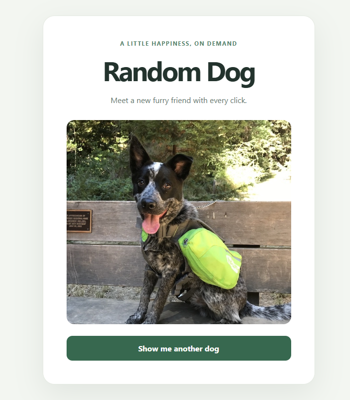

# Random Dog

A small React app that fetches and displays a random dog photo. Load a new
photo whenever you like, with clear loading and error states.

## Screenshot



## Features

- Loads a random dog photo when the app opens.
- Fetches and displays another photo when the button is clicked.
- Shows a loading message while a request is in progress and an error if it
  cannot load a photo.

## Getting started

Requirements: Node.js and npm.

```bash
npm install
npm run dev
```

Open the local URL printed by Vite.

## Tests

```bash
npm run test
```

## Data source

Dog photos are provided by the
[Dog CEO API](https://dog.ceo/dog-api/).
